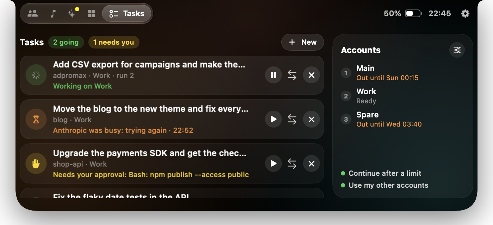
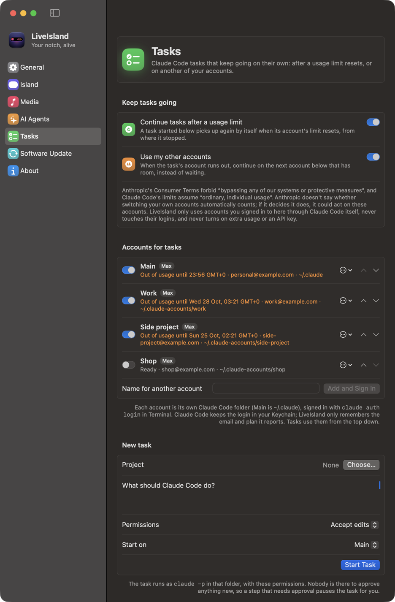
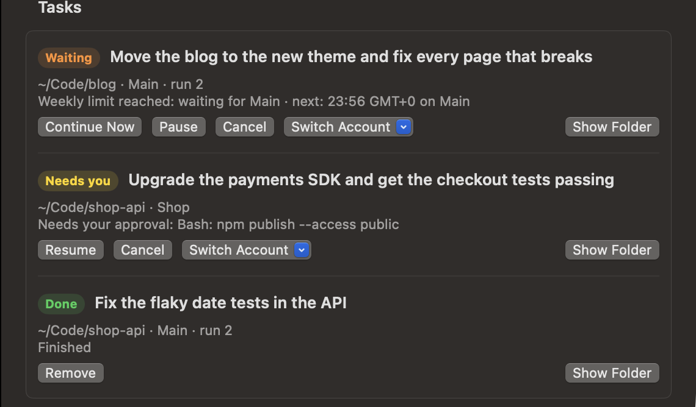

<div align="center">


# LiveIsland

### Your Claude Code work doesn't stop at a usage limit.

**A Dynamic Island for the Mac's notch that keeps your Claude Code tasks going across your accounts, and shows what's playing, who's working, and how much room each account has left.**


<br>



<sub>Main ran out, so the first task moved to Work and kept going. One task tries again while Anthropic is busy, one waits for your approval.</sub>

**[Install](#install)** · **[How tasks keep going](#tasks-that-keep-going)** · **[Screenshots](#screenshots)** · **[Features](#features)**

</div>

---

## The problem

You hand Claude Code a long job and walk away. Forty minutes later it has stopped:

> You've hit your session limit · resets 3:45pm

Nothing happens until you come back, sign in to another account and type "continue", and then explain where it was. If you pay for more than one account, the others sit idle the whole time. And the notch, a black bar in the middle of your screen, tells you none of this.

## The solution

LiveIsland turns the notch into a Dynamic Island that keeps an eye on your work for you.

- **Tasks keep going.** When the account a task runs on hits its 5-hour or weekly limit, LiveIsland continues the *same conversation*: as soon as the limit resets, or right away on the next of your accounts that has room. No signing in, no "continue", nothing to explain again.
- **Everything at a glance.** Which agent is working or waiting for you, how much of each account's limits is left and when it resets, what's playing, with a waveform that moves to the music.
- **It stays out of the way.** It opens on hover, clicks pass straight through, and it uses under 1% of one core when closed.

### Three steps

| 1. Sign in once | 2. Start a task | 3. Walk away |
|---|---|---|
| Add your accounts in **Settings › Tasks**. Claude Code signs in to each one itself, and LiveIsland never sees a login | Pick the project folder, say what to do, choose its permissions | When an account runs out, the task moves on or waits for the reset. Follow it from the island's **Tasks** tab |

## Screenshots

<table>
  <tr>
    <td align="center" width="33%">
      <br>
      <sub><b>Media</b><br>Any player, a real waveform, glow from the cover</sub>
    </td>
    <td align="center" width="33%">
      <br>
      <sub><b>Agents</b><br>Sessions, states, real usage limits</sub>
    </td>
    <td align="center" width="33%">
      <br>
      <sub><b>Activity</b><br>Timer, calendar, battery, devices, privacy</sub>
    </td>
  </tr>
  <tr>
    <td align="center" colspan="3">
      <br>
      <sub><b>In the notch</b><br>Claude and the music share it, like the iPhone</sub>
    </td>
  </tr>
  <tr>
    <td align="center" colspan="3">
      <br>
      <sub><b>Settings</b><br>Everything, in one window</sub>
    </td>
  </tr>
</table>

## Features

**Tasks that keep going**
- Start a Claude Code task in **Settings › Tasks** and leave: when its account hits a usage limit, it continues from where it stopped once the limit resets, or, if you turn it on, right away on another of your accounts
- Your accounts in the order you choose, each one's state and next reset; an account known to be out is never tried before its reset
- The island's **Tasks** tab: every task, its account, why it stopped and what happens next, with Pause, Continue, Switch Account and Cancel
- It pauses for you when something needs your approval, and never runs a conversation twice

**Now Playing**
- Works with any app that plays audio or video: Spotify, Music, browsers, podcasts…
- Reads **Spotify and Music directly** too, so a paused Spotify stays one tap away while a video plays in the browser. Switch players from the island
- A **real waveform** that moves with the music: bass pulses in the middle, treble at the edges, in the cover's colors (macOS 14.2+)
- Artwork with a **glow in the cover's colors**, drag to scrub, ±15 s, previous / play / next
- **Up Next** from Music's playlist, and **Recently Played** for Spotify and Music: tap a track to play it again
- System volume and output device right under the player
- Music or Spotify not open? Their icons are there; tap to open and play

**AI agents**
- Every **Claude Code** and **Codex** session: working (with a timer), needs you, done, idle
- **Jump to the session** in the app it runs in: VS Code, Cursor, Antigravity or Windsurf (the right window), Terminal or iTerm2 (the exact tab)
- Copy the command that resumes a session
- **Usage limits as rings**: Claude Code's real 5-hour and weekly percentages (one click to set up, see below), Codex's 5-hour and weekly limits, tokens this window and today
- **Several Claude and Codex accounts**: each one's limits side by side, an alert in the notch when the account in use runs out, and one-tap switching, also from the menu bar (see below)
- Optional sound when an agent finishes or stops to ask you something

**Calls, devices and the rest**
- Call timer for FaceTime, Zoom, Teams, Discord, WhatsApp, Slack and more
- Which app is using the **microphone**, and whether the **camera** is on
- **AirPods** battery (left, right, case) when they connect; charging, and time left on battery
- Quick **timers**, your next **calendar** events, and a heads-up in the notch 10 minutes before
- The most important thing wins the notch: a call beats an agent that needs you, which beats music
- **Two things at once**: while music plays, an agent or a timer shares the notch with the waveform, like the iPhone

**Everyday use**
- Opens on hover (or click), closes when you move away; clicks pass straight through everywhere else
- **Your tab order**: put Media, Agents, Activity, Accounts and Tasks in the order you like (Settings › Island). Beside a wide notch, the tabs show icons only rather than slide under the camera
- **Software Update** in Settings: see what's new and update in one click. It checks GitHub once a day (you can turn that off) and never installs on its own
- Settings window, menu bar panel, Open at Login, `liveisland://` links for Shortcuts
- Liquid Glass on macOS 26+, with a material fallback on earlier systems
- On Macs without a notch, the island sits at the top of the screen

## Claude Code limits

Claude Code shares its 5-hour and weekly percentages only with its status line. In **Settings › AI Agents**, click **Add to My Status Line**: LiveIsland adds three lines to your status line script, after it reads its input, and keeps a copy of the original next to it (`*.liveisland-backup`). The lines save the percentages to `~/.claude/liveisland-limits.json`, which the island reads.

Prefer to do it yourself? The lines are in [`scripts/claude-statusline-snippet.sh`](scripts/claude-statusline-snippet.sh). They go inside the status line script; typed into a terminal they do nothing. Without them, the island still shows Claude Code's tokens for the current 5-hour window and for today, counted from its transcripts.

## Claude and Codex accounts

<table>
  <tr>
    <td align="center" width="50%">
      <br>
      <sub><b>Claude Code</b><br>Every account's limits; ★ marks the one with the most room</sub>
    </td>
    <td align="center" width="50%">
      <br>
      <sub><b>Codex</b><br>ChatGPT logins, with their plan and limits</sub>
    </td>
  </tr>
</table>

Use more than one account? The **Accounts** tab lists every account Claude Code and Codex have used on this Mac, with its plan and its 5-hour and weekly limits; a Claude Code | Codex switch at the top picks the list. When the account in use runs out, the notch says so and points to the one with the most room. LiveIsland never switches on its own: you tap **Switch**.

Choose how Claude accounts switch in **Settings › AI Agents**:

| | |
|---|---|
| **Off** (default) | Limits and alerts only. You switch with `/login` in Claude Code. |
| **LiveIsland** | LiveIsland keeps a copy of each account's login in your login Keychain and puts it in place when you tap Switch. Only the Claude login changes: your MCP server logins stay as they are. It holds Claude Code's own locks while it switches, so a login refresh can't collide with it. New Claude Code sessions use the new account; sessions already running can keep the previous one until you restart them (`claude --continue` picks up where you left off). |
| **claude-swap** | LiveIsland asks [claude-swap](https://github.com/realiti4/claude-swap) to switch and shows its live usage for every account. LiveIsland itself never touches a login. |

To add an account, run `/login` in Claude Code and sign in to it (a private browser window helps if you're signed in to claude.ai as someone else). Avoid `/logout`: it can cancel the saved login of the account you leave. Use one switcher at a time, since each keeps its own copy of every login.

**Codex accounts** work the same way: the Accounts page has a Claude Code | Codex switch, and **Settings › AI Agents** has *Switch Codex accounts with LiveIsland* (off by default). LiveIsland then keeps a copy of each Codex login in its own folder, readable only by you, the same way Codex keeps its own in `~/.codex/auth.json`, and puts it in place when you tap Switch. Codex refuses to save a refreshed login over another account's, so a running session can't undo a switch. Add accounts with `codex login`; avoid `codex logout`, which cancels the login.

LiveIsland learns a Claude account's limits from the status line while you use it, and from the limit Claude reports when it refuses a request; a Codex account's come from the limits Codex writes in each session. Each report names the session it came from, and a session keeps the login it started with, so numbers land on an account only when that's certain: the session started after the latest switch, or the numbers match that account's own reset times. An account you aren't using keeps its last numbers, and a window that has reset counts from zero. (Added the status line lines with an earlier version? Settings › AI Agents offers to update them.)

## Tasks that keep going

<table>
  <tr>
    <td align="center" width="45%">
      <br>
      <sub><b>Settings › Tasks</b><br>The switches, your accounts in order, a new task</sub>
    </td>
    <td align="center" width="55%">
      <br>
      <sub><b>Each task</b><br>Where it stands, why, and what happens next</sub>
    </td>
  </tr>
</table>

Start a Claude Code task from **Settings › Tasks**, leave your Mac on, and LiveIsland keeps it going. When the account it runs on hits its 5-hour or weekly limit, the task picks up where it stopped once the limit resets, or, if you allow it, right away on another of your accounts.

**Set it up**

1. **Accounts.** *Main* is the account plain `claude` uses (`~/.claude`). To add another, type a name and click **Add and Sign In**: Terminal opens on Claude Code's own `claude auth login` for a new folder in `~/.claude-accounts`, and the row fills in once you've signed in. Turn each account on or off for tasks, and use the arrows to set the order they're used in.
2. **Switches.** **Continue tasks after a usage limit** waits for the reset; **Use my other accounts** moves to the next account with room instead. Both stay off until you turn them on.
3. **A task.** Choose the project folder, describe the work, pick the permissions (*Accept edits*, *Auto*, or *Ask*) and the account to start on, then click **Start Task**.

**When a run stops**

| The run ended because… | LiveIsland… |
|---|---|
| it finished | marks the task Done |
| the account hit its 5-hour or weekly limit | notes when that account resets, from Claude Code's own record of the refusal, then continues on the next account with room, or waits for the earliest reset. It never retries an account it knows is out |
| Anthropic was busy or unreachable | tries again on the same account, waiting a little longer each time |
| the account needs signing in again | sets it aside and moves on, or asks you to sign in |
| a step needed an approval nobody could give | pauses the task as **Needs you**, naming the step |
| you paused or cancelled it | stops. A cancelled task never starts again |

Follow your tasks from the island's **Tasks** tab: each task with its account, why it stopped and what happens next, with Pause, Continue, Switch Account and Cancel, and beside them your accounts in order, with when each one resets. Starting a task and adding accounts stay in Settings.

A task continues the same conversation with `claude --resume`: by its session on the same account, and by its transcript file on another, since each account keeps its own session list. If a conversation can't be resumed, a new one starts, briefed from the task's checkpoint (the files it changed, its last command and whether it passed, its last message), and the task says so. Before every run, LiveIsland checks that no other `claude` process has the conversation open, so a task never runs twice. Each task has **Pause**, **Cancel**, **Resume**, **Continue Now** and **Switch Account**.

**Good to know**

- LiveIsland never sees a login: each account's sign-in stays in Claude Code's own Keychain entry for its folder. Runs get no API key or token from LiveIsland, so nothing is billed to an API key, and LiveIsland never turns on extra usage.
- Tasks run as `claude -p` in the folder you chose, with the permissions you picked. A step outside them pauses the task; it never asks for more.
- Only tasks started here keep going. For sessions you run yourself in Terminal or an editor, Claude Code can wait for the reset on its own: turn on *Continue automatically at usage limit* in `/config`. Claude Desktop isn't supported.
- Anthropic doesn't say whether switching your own accounts automatically is allowed. Its Consumer Terms forbid "bypassing any of our systems or protective measures", and Claude Code's limits assume "ordinary, individual usage". Decide for yourself before turning on **Use my other accounts**.

## How it works

| What | Where it comes from |
|---|---|
| Now playing (any app) | MediaRemote, through the bundled [mediaremote-adapter](https://github.com/ungive/mediaremote-adapter): since macOS 15.4 only Apple-signed processes may read it, so the adapter runs inside `/usr/bin/perl` |
| Spotify and Music | Their own "track changed" notifications, and AppleScript for details and controls. LiveIsland never scripts an app that isn't running, since that would open it |
| Claude Code and Codex | Their session files (`~/.claude/projects`, `~/.codex/sessions`), watched with FSEvents. Transcripts can be gigabytes, so only new bytes are read |
| Where a session runs | The process table: each agent's folder and terminal, and the app above it |
| Claude accounts | Who's logged in from `~/.claude.json`; logins (only when you choose LiveIsland switching) through the system `security` tool, the way Claude Code itself stores them |
| Codex accounts | Who's logged in, and the plan, from `~/.codex/auth.json`; limits from the `rate_limits` Codex writes in each session; logins (only when you turn on Codex switching) as private copies of that file in `~/Library/Application Support/LiveIsland` |
| Microphone, camera, calls | Core Audio's process list and CoreMediaIO. Only *whether* they're in use, never what they hear or see |
| Waveform | A Core Audio process tap on what the Mac plays (macOS 14.2+), only while music plays and the bars are on screen. It only listens: the sound is never changed, muted, recorded or stored, just measured band by band |
| Battery, AirPods | IOKit power notifications; IOBluetooth and `system_profiler` for AirPods levels |
| Calendar | EventKit, read only |
| Tasks | `claude -p` with stream-json output, in the task's folder and permission mode. Each account is a Claude Code profile (`CLAUDE_CONFIG_DIR`) that Claude Code itself signs in to with `claude auth login`; LiveIsland keeps only the profile's folder, email and plan. A usage limit and its reset time come from the `rate_limit_info` Claude Code writes in the transcript. A run continues the same conversation with `--resume`, by session ID on the same account and by the transcript's path on another, and never starts while another `claude` process has that conversation open |
| Updates | This repository's latest GitHub release, at most once a day. A new version must match its SHA-256, be LiveIsland at the version promised and pass `codesign --verify` before it replaces the app |

## Performance

Measured on an M4 Pro with Claude Code and Codex running and Spotify playing:

| | CPU |
|---|---|
| Island closed | under 1% of one core |
| Island open | about 9% while it's on screen (drawing) |
| First read of 460 Claude Code transcripts (2 GB) | about 3 s, once, in the background |
| Checking them again | 16 ms |

Nothing animates frame by frame unless you can see it: spinners and waveforms are drawn by Core Animation, clocks tick once a second, and mouse moves far from the notch are ignored.

## Install

**Download** the latest release (macOS 14 or later, Apple silicon and Intel) and open it, in one Terminal command:

```bash
curl -fL https://github.com/charonova/LiveIsland/releases/latest/download/LiveIsland.zip -o /tmp/LiveIsland.zip \
  && mkdir -p ~/Applications && ditto -xk /tmp/LiveIsland.zip ~/Applications && open ~/Applications/LiveIsland.app
```

LiveIsland isn't notarized by Apple yet (that needs a paid developer account), so a copy downloaded in a browser gets "Apple could not verify LiveIsland" the first time. Installed with the command above, it opens right away. If you downloaded [the zip](https://github.com/charonova/LiveIsland/releases/latest) in a browser, unzip it, move LiveIsland to Applications, open it once, then click **Open Anyway** in **System Settings › Privacy & Security**.

After that, new versions install from **Settings › Software Update**.

**Build it yourself** instead, with the Xcode Command Line Tools and CMake (`brew install cmake`, for the media adapter):

```bash
git clone https://github.com/charonova/LiveIsland.git
cd LiveIsland
./scripts/install.sh   # builds, copies to ~/Applications and launches
```

macOS will ask for:

- **Calendar**, for your next events
- **Bluetooth**, for AirPods battery
- **Automation** for Spotify and Music (now playing and controls), and for Terminal or iTerm2 the first time you jump to a session there
- **System audio recording**, for the live waveform, the first time music plays. Without it the island shows the animated symbol; you can turn the waveform off in Settings › Media
- Nothing for Claude or Codex accounts: switching is off until you turn it on, the Keychain items it uses are written by the system `security` tool, and Codex logins are plain files in LiveIsland's own folder

Everything works without any of them; the matching feature just stays empty.

## Updates

**Settings › Software Update** shows the version you have, and whether a newer one is out on GitHub with what's new. **Update Now** downloads it, checks it (its SHA-256, that it's LiveIsland at the version promised, and its signature), puts it in place of the running app and reopens it. LiveIsland looks for a new version once a day; turn that off on the same page. Until LiveIsland is notarized by Apple, macOS may ask again for its permissions after an update.

## Tests

```bash
./scripts/test.sh                                   # all tests
LIVEISLAND_REAL_DATA=1 ./scripts/test.sh -c release --filter RealData   # read your own transcripts, timed
```

The tests cover the transcript and rollout parsers, the incremental usage ledger (appends, truncation, replaced files, duplicate messages), 5-hour windows, limit notices that go stale, Claude Code's status line limits, now-playing stream updates, the waveform's bands (bass and treble in the right bars, a beat shows as movement, a quiet track moves like a loud one, silence stays flat), activity priorities, the tab order (kept as tabs come and go), software updates (versions compared number by number, GitHub's release answer, checksums), tasks (how a run ended: a usage limit with or without a reset time, throttling, network, signing in, approvals; the account chosen next, never one known to be out; waiting for the earliest reset; cancelling; one run per conversation; the checkpoint and the prompts that continue from it), timers, session resume commands and editor window matching. For accounts: editing `~/.claude.json` without touching anything but `oauthAccount`, replacing the Claude login while keeping MCP logins, filing each status line report under the right account after a switch, limits from refused requests, the account with the most room, and reading claude-swap's output. For Codex: who a login belongs to (from its ID token), ChatGPT plan names, Codex limits in the account book, and listing Codex accounts apart from Claude ones.

## Automation

| Link | Action |
|---|---|
| `liveisland://open` · `close` | Open or close the island |
| `liveisland://open/accounts` | Open it on a page: `media`, `agents`, `activity`, `accounts` (`accounts/codex` for the Codex list) or `tasks` |
| `liveisland://timer/5` | Start a 5-minute timer |
| `liveisland://update` · `update/install` | Check for a new version, and install it |
| `liveisland://settings` · `settings/agents` | Open Settings, or one of its pages: `general`, `island`, `media`, `agents`, `tasks`, `updates`, `about` |

## Privacy

LiveIsland has no analytics and no accounts. Transcripts, calendar events and everything else stay on your Mac. The waveform measures the sound in memory and never records or keeps it. Its only network requests download Spotify's cover art, from the address Spotify itself gives, and ask GitHub once a day whether a newer LiveIsland is out (turn that off in Settings › Software Update). Tasks run Claude Code on your Mac with your own accounts; their checkpoints stay in `~/Library/Application Support/LiveIsland/automation`, and runs never get an API key or token from LiveIsland's environment, so nothing is billed to an API key behind your back.

## Credits

Now playing uses [mediaremote-adapter](https://github.com/ungive/mediaremote-adapter) by ungive (BSD-3-Clause), vendored in `ThirdParty/`. Claude Code, Codex, Spotify and the other apps named here belong to their owners; LiveIsland isn't affiliated with them.

## License

[MIT](LICENSE) © 2026 Aissam Irhir
