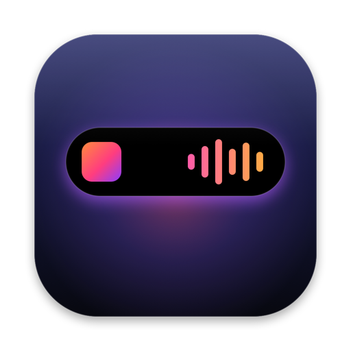
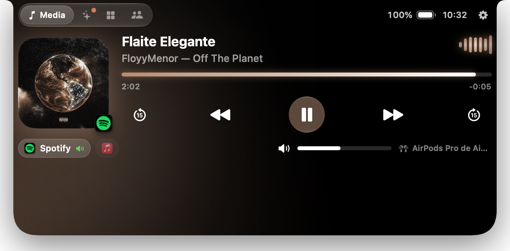
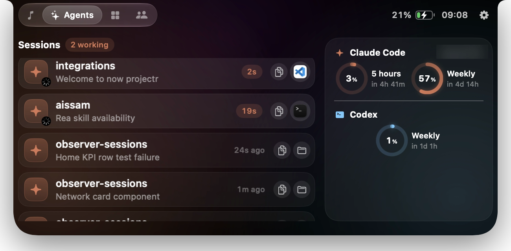
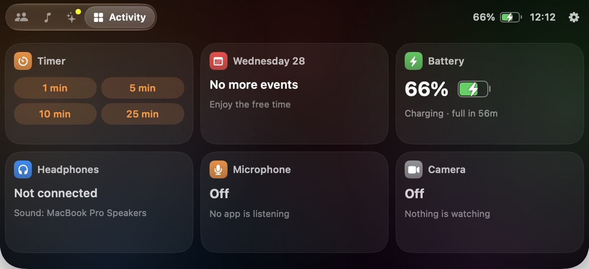
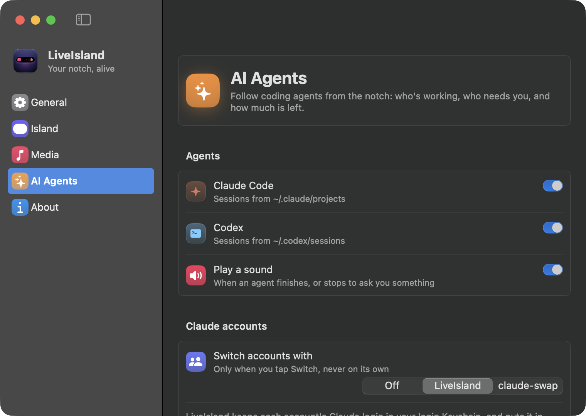
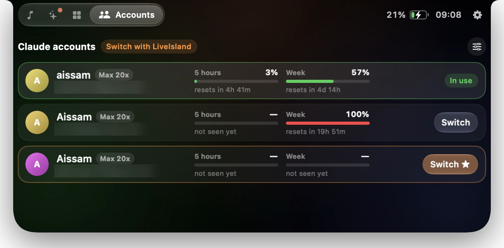
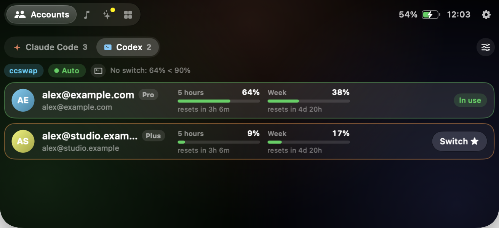

<div align="center">



# LiveIsland

**A Dynamic Island for the Mac's notch: what's playing, your AI agents and their limits, calls, AirPods, timers and your calendar.**


<br>




<sub>The Media page with its live waveform, and the notch shared by Claude Code and the music, like the iPhone's.</sub>

</div>

---

## Screenshots

<table>
  <tr>
    <td align="center" width="33%">
      <br>
      <sub><b>Agents</b><br>Sessions, states, real usage limits</sub>
    </td>
    <td align="center" width="33%">
      <br>
      <sub><b>Activity</b><br>Timer, calendar, battery, devices, privacy</sub>
    </td>
    <td align="center" width="33%">
      <br>
      <sub><b>Settings</b><br>Everything, in one window</sub>
    </td>
  </tr>
</table>

## Features

**Now Playing**
- Works with any app that plays audio or video: Spotify, Music, browsers, podcasts…
- Reads **Spotify and Music directly** too, so a paused Spotify stays one tap away while a video plays in the browser. Switch players from the island
- Artwork with a **glow in the cover's colors**, drag to scrub, ±15 s, previous / play / next
- A **real waveform** that moves with the music: bass pulses in the middle, treble at the edges, in the cover's colors (macOS 14.2+)
- **Up Next** from Music's playlist, and **Recently Played** for Spotify and Music: tap a track to play it again
- System volume and output device right under the player
- Music or Spotify not open? Their icons are there; tap to open and play

**AI agents**
- Every **Claude Code** and **Codex** session: working (with a timer), needs you, done, idle
- **Jump to the session** in the app it runs in: VS Code, Cursor, Antigravity or Windsurf (the right window), Terminal or iTerm2 (the exact tab)
- Copy the command that resumes a session
- **Usage limits as rings**: Claude Code's real 5-hour and weekly percentages (one click to set up, see below), Codex's 5-hour and weekly limits, tokens this window and today
- Optional sound when an agent finishes or stops to ask you something
- **Several Claude and Codex accounts**: each one's limits side by side, an alert in the notch when the account in use runs out, and one-tap switching, also from the menu bar (see below)

**Calls, devices and the rest**
- Call timer for FaceTime, Zoom, Teams, Discord, WhatsApp, Slack and more
- Which app is using the **microphone**, and whether the **camera** is on
- **AirPods** battery (left, right, case) when they connect; charging, and time left on battery
- Quick **timers**, your next **calendar** events, and a heads-up in the notch 10 minutes before
- The most important thing wins the notch: a call beats an agent that needs you, which beats music
- **Two things at once**: while music plays, an agent or a timer shares the notch with the waveform, like the iPhone

**Everyday use**
- Opens on hover (or click), closes when you move away; clicks pass straight through everywhere else
- Settings window, menu bar panel, Open at Login, `liveisland://` links for Shortcuts
- Liquid Glass on macOS 26+, with a material fallback on earlier systems
- On Macs without a notch, the island sits at the top of the screen

## Claude Code limits

Claude Code shares its 5-hour and weekly percentages only with its status line. In **Settings › AI Agents**, click **Add to My Status Line**: LiveIsland adds three lines to your status line script, after it reads its input, and keeps a copy of the original next to it (`*.liveisland-backup`). The lines save the percentages to `~/.claude/liveisland-limits.json`, which the island reads.

Prefer to do it yourself? The lines are in [`scripts/claude-statusline-snippet.sh`](scripts/claude-statusline-snippet.sh). They go inside the status line script; typed into a terminal they do nothing. Without them, the island still shows Claude Code's tokens for the current 5-hour window and for today, counted from its transcripts.

## Claude and Codex accounts

<table>
  <tr>
    <td align="center" width="50%">
      <br>
      <sub><b>Claude Code</b><br>Every account's limits; ★ marks the one with the most room</sub>
    </td>
    <td align="center" width="50%">
      <br>
      <sub><b>Codex</b><br>ChatGPT logins, with their plan and limits</sub>
    </td>
  </tr>
</table>

Use more than one account? The **Accounts** tab lists every account Claude Code and Codex have used on this Mac, with its plan and its 5-hour and weekly limits; a Claude Code | Codex switch at the top picks the list. When the account in use runs out, the notch says so and points to the one with the most room. LiveIsland never switches on its own: you tap **Switch**.

Choose how Claude accounts switch in **Settings › AI Agents**:

| | |
|---|---|
| **Off** (default) | Limits and alerts only. You switch with `/login` in Claude Code. |
| **LiveIsland** | LiveIsland keeps a copy of each account's login in your login Keychain and puts it in place when you tap Switch. Only the Claude login changes: your MCP server logins stay as they are. It holds Claude Code's own locks while it switches, so a login refresh can't collide with it. New Claude Code sessions use the new account; sessions already running can keep the previous one until you restart them (`claude --continue` picks up where you left off). |
| **claude-swap** | LiveIsland asks [claude-swap](https://github.com/realiti4/claude-swap) to switch and shows its live usage for every account. LiveIsland itself never touches a login. |

To add an account, run `/login` in Claude Code and sign in to it (a private browser window helps if you're signed in to claude.ai as someone else). Avoid `/logout`: it can cancel the saved login of the account you leave. Use one switcher at a time, since each keeps its own copy of every login.

**Codex accounts** work the same way: the Accounts page has a Claude Code | Codex switch, and **Settings › AI Agents** has *Switch Codex accounts with LiveIsland* (off by default). LiveIsland then keeps a copy of each Codex login in its own folder, readable only by you, the same way Codex keeps its own in `~/.codex/auth.json`, and puts it in place when you tap Switch. Codex refuses to save a refreshed login over another account's, so a running session can't undo a switch. Add accounts with `codex login`; avoid `codex logout`, which cancels the login.

LiveIsland learns a Claude account's limits from the status line while you use it, and from the limit Claude reports when it refuses a request; a Codex account's come from the limits Codex writes in each session. Each report names the session it came from, and a session keeps the login it started with, so numbers land on an account only when that's certain: the session started after the latest switch, or the numbers match that account's own reset times. An account you aren't using keeps its last numbers, and a window that has reset counts from zero. (Added the status line lines with an earlier version? Settings › AI Agents offers to update them.)

## How it works

| What | Where it comes from |
|---|---|
| Now playing (any app) | MediaRemote, through the bundled [mediaremote-adapter](https://github.com/ungive/mediaremote-adapter): since macOS 15.4 only Apple-signed processes may read it, so the adapter runs inside `/usr/bin/perl` |
| Spotify and Music | Their own "track changed" notifications, and AppleScript for details and controls. LiveIsland never scripts an app that isn't running, since that would open it |
| Claude Code and Codex | Their session files (`~/.claude/projects`, `~/.codex/sessions`), watched with FSEvents. Transcripts can be gigabytes, so only new bytes are read |
| Where a session runs | The process table: each agent's folder and terminal, and the app above it |
| Claude accounts | Who's logged in from `~/.claude.json`; logins (only when you choose LiveIsland switching) through the system `security` tool, the way Claude Code itself stores them |
| Codex accounts | Who's logged in, and the plan, from `~/.codex/auth.json`; limits from the `rate_limits` Codex writes in each session; logins (only when you turn on Codex switching) as private copies of that file in `~/Library/Application Support/LiveIsland` |
| Microphone, camera, calls | Core Audio's process list and CoreMediaIO. Only *whether* they're in use, never what they hear or see |
| Waveform | A Core Audio process tap on what the Mac plays (macOS 14.2+), only while music plays and the bars are on screen. It only listens: the sound is never changed, muted, recorded or stored, just measured band by band |
| Battery, AirPods | IOKit power notifications; IOBluetooth and `system_profiler` for AirPods levels |
| Calendar | EventKit, read only |

## Performance

Measured on an M4 Pro with Claude Code and Codex running and Spotify playing:

| | CPU |
|---|---|
| Island closed | under 1% of one core |
| Island open | about 9% while it's on screen (drawing) |
| First read of 460 Claude Code transcripts (2 GB) | about 3 s, once, in the background |
| Checking them again | 16 ms |

Nothing animates frame by frame unless you can see it: spinners and waveforms are drawn by Core Animation, clocks tick once a second, and mouse moves far from the notch are ignored.

## Install

**Download** the latest release (macOS 14 or later, Apple silicon and Intel) and open it, in one Terminal command:

```bash
curl -fL https://github.com/charonova/LiveIsland/releases/latest/download/LiveIsland.zip -o /tmp/LiveIsland.zip \
  && mkdir -p ~/Applications && ditto -xk /tmp/LiveIsland.zip ~/Applications && open ~/Applications/LiveIsland.app
```

LiveIsland isn't notarized by Apple yet (that needs a paid developer account), so a copy downloaded in a browser gets "Apple could not verify LiveIsland" the first time. Installed with the command above, it opens right away. If you downloaded [the zip](https://github.com/charonova/LiveIsland/releases/latest) in a browser, unzip it, move LiveIsland to Applications, open it once, then click **Open Anyway** in **System Settings › Privacy & Security**.

**Build it yourself** instead, with the Xcode Command Line Tools and CMake (`brew install cmake`, for the media adapter):

```bash
git clone https://github.com/charonova/LiveIsland.git
cd LiveIsland
./scripts/install.sh   # builds, copies to ~/Applications and launches
```

macOS will ask for:

- **Calendar**, for your next events
- **Bluetooth**, for AirPods battery
- **Automation** for Spotify and Music (now playing and controls), and for Terminal or iTerm2 the first time you jump to a session there
- **System audio recording**, for the live waveform, the first time music plays. Without it the island shows the animated symbol; you can turn the waveform off in Settings › Media
- Nothing for Claude or Codex accounts: switching is off until you turn it on, the Keychain items it uses are written by the system `security` tool, and Codex logins are plain files in LiveIsland's own folder

Everything works without any of them; the matching feature just stays empty.

## Tests

```bash
./scripts/test.sh                                   # all tests
LIVEISLAND_REAL_DATA=1 ./scripts/test.sh -c release --filter RealData   # read your own transcripts, timed
```

The tests cover the transcript and rollout parsers, the incremental usage ledger (appends, truncation, replaced files, duplicate messages), 5-hour windows, limit notices that go stale, Claude Code's status line limits, now-playing stream updates, the waveform's bands (bass and treble in the right bars, a beat shows as movement, a quiet track moves like a loud one, silence stays flat), activity priorities, timers, session resume commands and editor window matching. For accounts: editing `~/.claude.json` without touching anything but `oauthAccount`, replacing the Claude login while keeping MCP logins, filing each status line report under the right account after a switch, limits from refused requests, the account with the most room, and reading claude-swap's output. For Codex: who a login belongs to (from its ID token), ChatGPT plan names, Codex limits in the account book, and listing Codex accounts apart from Claude ones.

## Automation

| Link | Action |
|---|---|
| `liveisland://open` · `close` | Open or close the island |
| `liveisland://open/accounts` | Open it on a page: `media`, `agents`, `activity` or `accounts` (`accounts/codex` for the Codex list) |
| `liveisland://timer/5` | Start a 5-minute timer |
| `liveisland://settings` · `settings/agents` | Open Settings, or one of its pages: `general`, `island`, `media`, `agents`, `about` |

## Privacy

LiveIsland has no analytics and no accounts. Transcripts, calendar events and everything else stay on your Mac. The waveform measures the sound in memory and never records or keeps it. Its only network request downloads Spotify's cover art, from the address Spotify itself gives.

## Credits

Now playing uses [mediaremote-adapter](https://github.com/ungive/mediaremote-adapter) by ungive (BSD-3-Clause), vendored in `ThirdParty/`. Claude Code, Codex, Spotify and the other apps named here belong to their owners; LiveIsland isn't affiliated with them.

## License

[MIT](LICENSE) © 2026 Aissam Irhir
