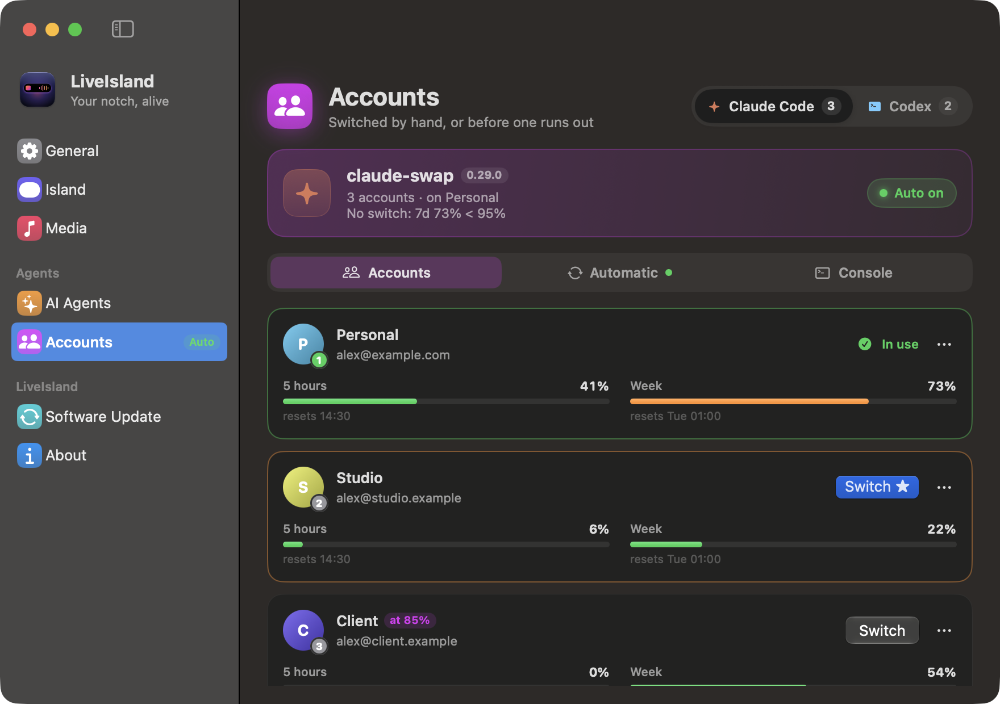
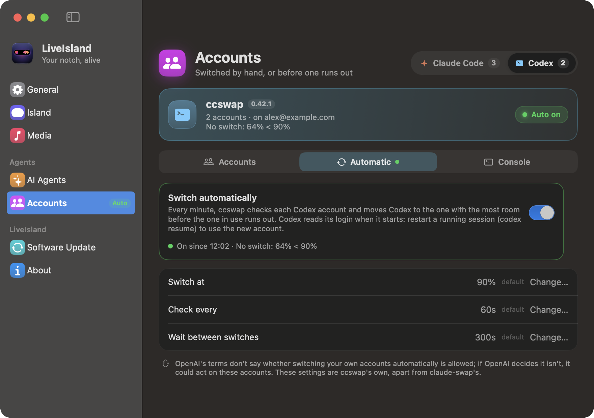
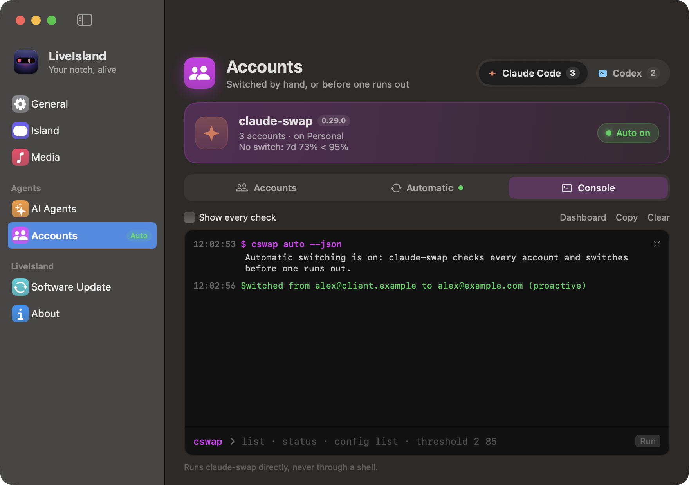
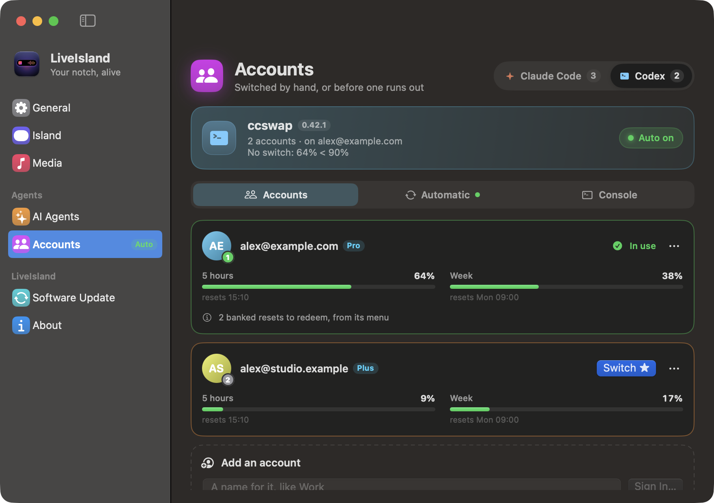
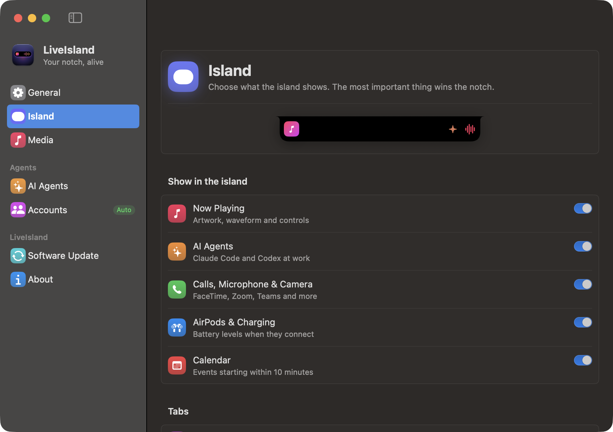

<div align="center">


# LiveIsland

### Your coding agents don't stop at a usage limit.

A Dynamic Island for the Mac's notch. It moves **Claude Code** and **Codex** to your next account before the one in use runs out, and shows who's working, what's playing, and how much room every account has left.


<br>


**[Install](#install)** · **[How switching works](#how-switching-works)** · **[Everything it does](#everything-it-does)** · **[Privacy](#privacy)**

</div>

---

## Why

You hand Claude Code or Codex a long job and walk away. Forty minutes later it has stopped:

> You've hit your session limit · resets 3:45pm

Nothing moves until you come back, sign in to another account and type "continue". If you pay for more than one account, the others sat idle the whole time. And the notch, a black bar in the middle of your screen, told you none of it.

**LiveIsland keeps the work going.**

| | Without LiveIsland | With LiveIsland |
|---|---|---|
| **An account runs out** | The agent stops until you notice | It moves to the account with the most room *before* the limit |
| **Several accounts** | Log out, log in, guess which one has room | Every account's 5-hour and weekly use side by side, one click to switch |
| **What the tools did** | Hidden in a terminal | A console with every command, check and switch |
| **Which agent needs you** | Check every window | The notch says so, and jumps to the right tab |

## Install

macOS 14 or later, Apple silicon and Intel. One command downloads and opens it:

```bash
curl -fL https://github.com/charonova/LiveIsland/releases/latest/download/LiveIsland.zip -o /tmp/LiveIsland.zip \
  && mkdir -p ~/Applications && ditto -xk /tmp/LiveIsland.zip ~/Applications && open ~/Applications/LiveIsland.app
```

LiveIsland isn't notarized by Apple yet (that needs a paid developer account). Installed with the command above, it opens right away. From a browser download, unzip it, move it to Applications, open it once, then click **Open Anyway** in **System Settings › Privacy & Security**. After that, new versions install from **Settings › Software Update**.

Then set up switching in three steps:

| 1. Install the switcher | 2. Add your accounts | 3. Turn on Auto |
|---|---|---|
| **Settings › Accounts**, pick **Claude Code** or **Codex**, click **Install** | Type a name, click **Sign In…**. The tool's own sign-in opens; the account in use stays as it is | **Auto on**. It switches before the account in use runs out |

## How switching works

LiveIsland doesn't switch accounts itself. It runs two open-source tools that do: [claude-swap](https://github.com/realiti4/claude-swap) for Claude Code and [ccswap](https://github.com/errhythm/ccswap) for Codex. They hold the logins; LiveIsland installs them, keeps them running, and shows everything they do. It never reads a login.

<table>
  <tr>
    <td width="50%"></td>
    <td width="50%"></td>
  </tr>
  <tr>
    <td align="center"><sub><b>Accounts</b> · a card per account: its limits, Switch, and a menu</sub></td>
    <td align="center"><sub><b>Automatic</b> · on or off, the last check, the switch points</sub></td>
  </tr>
  <tr>
    <td width="50%"></td>
    <td width="50%"></td>
  </tr>
  <tr>
    <td align="center"><sub><b>Console</b> · every command and switch, as text; type your own</sub></td>
    <td align="center"><sub><b>Codex</b> · the same page, with ccswap</sub></td>
  </tr>
</table>

**Settings › Accounts** has a **Claude Code | Codex** switch. The card at the top shows the tool, its version, the account in use, the last check and **Auto**; its **⋯** menu checks for updates. Below it, three tabs:

- **Accounts**: one card per account with its 5-hour and weekly bars and reset times. **Switch ★** marks the one with the most room. A Claude account's menu keeps it out of rotation, renames it, gives it its own switch point, moves it or removes it. A Codex account's menu redeems a banked reset or removes it. The last card adds an account.
- **Automatic**: the switch, what the last check found, and the tool's own settings. These are each tool's own settings, so changing one here is the same as `cswap config set`. claude-swap has a switch point for the 5-hour and the weekly limit, a wait between switches, and a choice between the most room or the soonest weekly reset. ccswap has its switch point, how often it checks, and the wait.
- **Console**: every command LiveIsland ran, with its output and exit code, and every switch, refusal and restart as it happens. Type any other command below it; it runs directly, never through a shell.

The island's **Accounts** tab has the same switch, with each tool's **Auto** button and a shortcut to its console.

<p align="center"></p>

**Claude Code.** Install runs `uv tool install claude-swap`, with pipx, or Homebrew's uv, as a fallback. **Sign In…** opens Claude Code's own `claude auth login` in a folder of its own under `~/.claude-accounts`, then adds it with `cswap add`. While Auto is on, LiveIsland runs `cswap auto --json`, restarts it if it stops, and shows each switch in the notch. Running sessions follow a switch within about 30 seconds. Don't sign those folders out later: claude-swap holds the same logins, and signing out cancels them.

**Codex.** ccswap is a fork of claude-swap that adds Codex, and it installs next to claude-swap without changing it. LiveIsland runs only its Codex commands, with its data in LiveIsland's own folder, so claude-swap's accounts and settings stay as they are. **Sign In…** opens `codex login` in a temporary folder, adds the account, then deletes the folder. Codex reads its login when it starts, so restart a running session (`codex resume`) after a switch. Avoid `codex logout` on an account ccswap holds.

> [!NOTE]
> Neither Anthropic nor OpenAI says whether switching your own accounts automatically is allowed. Anthropic's Consumer Terms forbid "bypassing any of our systems or protective measures", and Claude Code's limits assume "ordinary, individual usage". Auto stays off until you turn it on, and accounts that bill an API key stay out of rotation.

## Everything it does

<table>
  <tr>
    <td width="33%"></td>
    <td width="33%"></td>
    <td width="33%"></td>
  </tr>
  <tr>
    <td align="center"><sub><b>Agents</b> · who's working, who needs you, real limits</sub></td>
    <td align="center"><sub><b>Media</b> · any player, a real waveform</sub></td>
    <td align="center"><sub><b>Activity</b> · timers, calendar, battery, devices</sub></td>
  </tr>
</table>

**Agents**
- Every Claude Code and Codex session: working (with a timer), needs you, done, idle
- Jump to a session in the app it runs in: VS Code, Cursor, Windsurf or Antigravity (the right window), Terminal or iTerm2 (the exact tab), or copy its resume command
- Claude Code's and Codex's 5-hour and weekly limits as rings, plus tokens this window and today
- An optional sound when an agent finishes or asks you something

**Now playing**
- Any app that plays audio or video; Spotify and Music read directly, so a paused Spotify stays one tap away while a video plays
- A real waveform that moves with the music (macOS 14.2+), a glow from the cover, scrubbing, ±15 s, Up Next and Recently Played
- System volume and output device under the player

**Everything else**
- Calls (FaceTime, Zoom, Teams, Discord, Slack…), which app uses the microphone, whether the camera is on
- AirPods battery for left, right and case; charging and time left
- Quick timers, your next meetings, and a heads-up 10 minutes before
- Two things at once: while music plays, an agent or a timer shares the notch with the waveform, like the iPhone
- The most important thing wins the notch: a call beats an agent that needs you, which beats music

**Everyday**
- Opens on hover or click and closes when you move away; clicks pass straight through everywhere else
- Under 1% of one core while closed: nothing animates frame by frame unless you can see it
- Your tab order, Software Update in one click, Open at Login, a menu bar panel, and Liquid Glass on macOS 26
- `liveisland://` links for Shortcuts, Raycast or a terminal (see [Links](#links))

<p align="center"></p>

### Claude Code's limits

Claude Code shares its 5-hour and weekly percentages only with its status line. In **Settings › AI Agents**, click **Add to My Status Line**. LiveIsland adds three lines to your status line script, after it reads its input, and keeps a copy of the original next to it (`*.liveisland-backup`). The lines save the percentages to `~/.claude/liveisland-limits.json`, which the island reads. To add them yourself, they're in [`scripts/claude-statusline-snippet.sh`](scripts/claude-statusline-snippet.sh). Without them, the island still counts Claude Code's tokens from its transcripts.

## Privacy

- **No analytics, no accounts.** Transcripts, calendar events and everything else stay on your Mac.
- **No logins.** claude-swap keeps the Claude logins in your Keychain, and ccswap keeps the Codex logins as private files in LiveIsland's folder. LiveIsland only shows what they say, and keeps the console in memory.
- **The waveform only listens.** It measures the sound in memory, only while music plays and the bars are on screen, and never changes, records or keeps it.
- **Few network requests.** LiveIsland downloads Spotify's cover art and checks GitHub once a day for a new version, which you can turn off. claude-swap and ccswap ask Anthropic and OpenAI for each account's use, as they do on their own.

macOS asks for **Calendar**, **Bluetooth** (AirPods), **Automation** (Spotify, Music, and Terminal or iTerm2 when you jump to a session) and **System audio recording** (the waveform). Everything works without them; that feature just stays empty.

## How it's built

| What | Where it comes from |
|---|---|
| Now playing | MediaRemote through the bundled [mediaremote-adapter](https://github.com/ungive/mediaremote-adapter), run inside `/usr/bin/perl` since macOS 15.4 allows only Apple-signed readers; Spotify and Music via their notifications and AppleScript, never scripting an app that isn't running |
| Agents | `~/.claude/projects` and `~/.codex/sessions`, watched with FSEvents. Transcripts can be gigabytes, so only new bytes are read |
| Accounts | `cswap list --json`, `cswap auto --json`, `ccswap codex list`, `usage` and `auto --json`, each run directly, never through a shell |
| Mic, camera, calls | Core Audio's process list and CoreMediaIO: only *whether* they're in use |
| Waveform | A read-only Core Audio process tap, drawn by Core Animation 30 times a second |
| Battery, AirPods, calendar | IOKit, IOBluetooth and EventKit (read only) |
| Updates | The latest GitHub release, which must match its SHA-256, be LiveIsland at the promised version, and pass `codesign --verify` |

Measured on an M4 Pro with Claude Code and Codex running and Spotify playing: under 1% of one core with the island closed, about 9% while it's open, and about 3 s once (in the background) to read 460 transcripts totalling 2 GB.

**Build it yourself** with the Xcode Command Line Tools and CMake (`brew install cmake`):

```bash
git clone https://github.com/charonova/LiveIsland.git && cd LiveIsland
./scripts/install.sh   # builds, copies to ~/Applications and launches
./scripts/test.sh      # 105 tests
```

## Links

| Link | Does |
|---|---|
| `liveisland://open` · `close` | Open or close the island; `open/media`, `agents`, `activity`, `accounts`, `accounts/codex` pick a page |
| `liveisland://settings/accounts/codex/console` | Open Settings on a page: `general`, `island`, `media`, `agents`, `accounts` (then `claude` or `codex`, and `automatic` or `console`), `updates`, `about` |
| `liveisland://timer/5` | Start a 5-minute timer |
| `liveisland://update` · `update/install` | Check for a new version, and install it |

## Credits

Now playing uses [mediaremote-adapter](https://github.com/ungive/mediaremote-adapter) by ungive (BSD-3-Clause), vendored in `ThirdParty/`. Account switching is [claude-swap](https://github.com/realiti4/claude-swap) by realiti4 (MIT) and [ccswap](https://github.com/errhythm/ccswap) by errhythm (MIT), each installed separately. Claude Code, Codex, Spotify and the other apps named here belong to their owners; LiveIsland isn't affiliated with them.

[MIT](LICENSE) © 2026 Aissam Irhir
