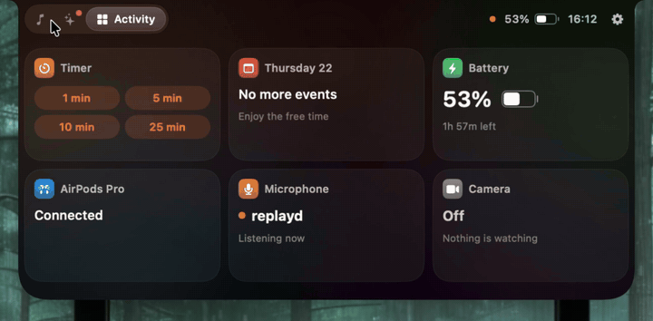
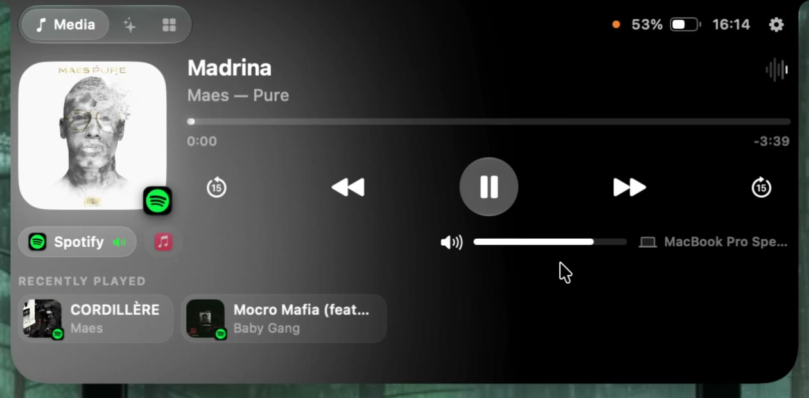
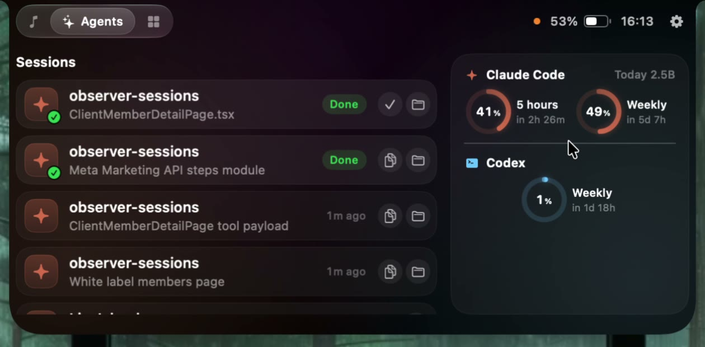
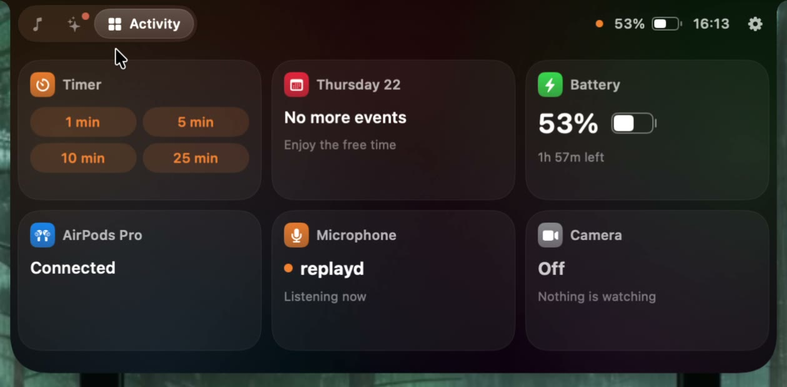
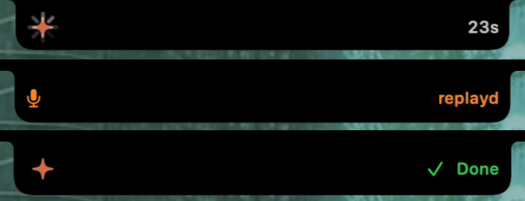
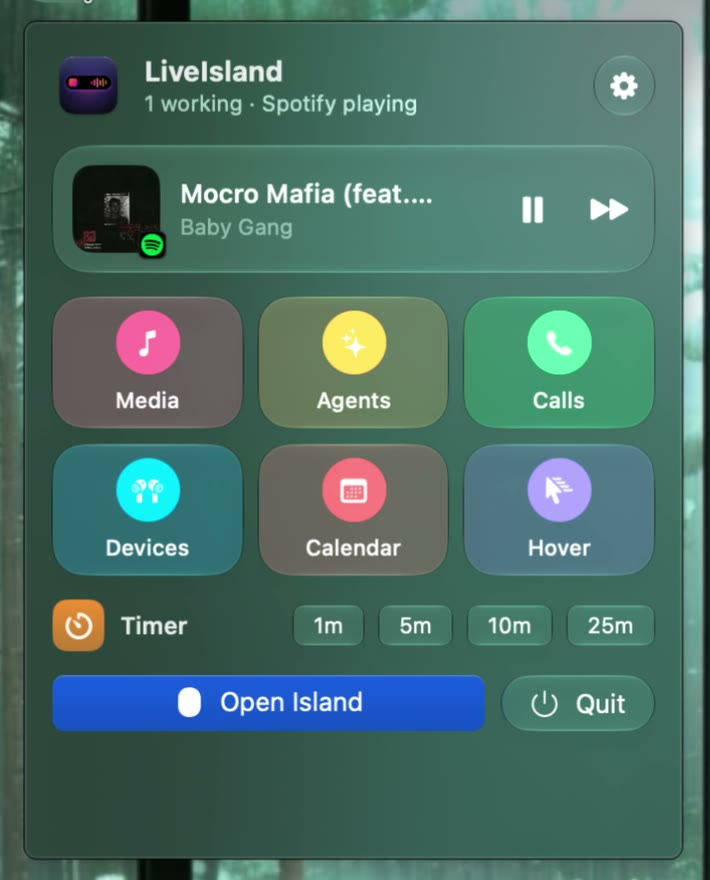
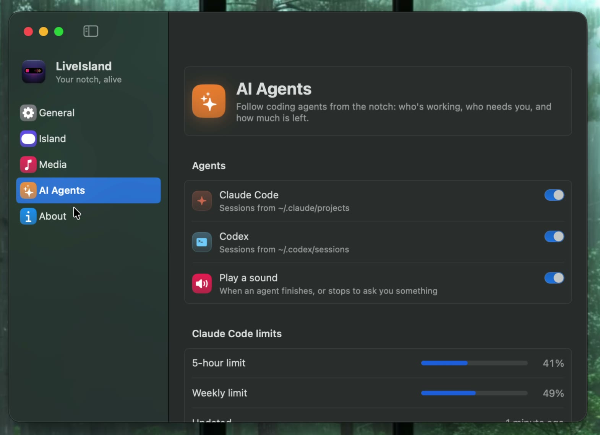
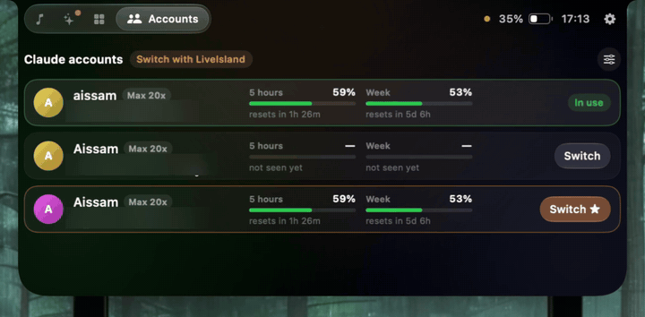
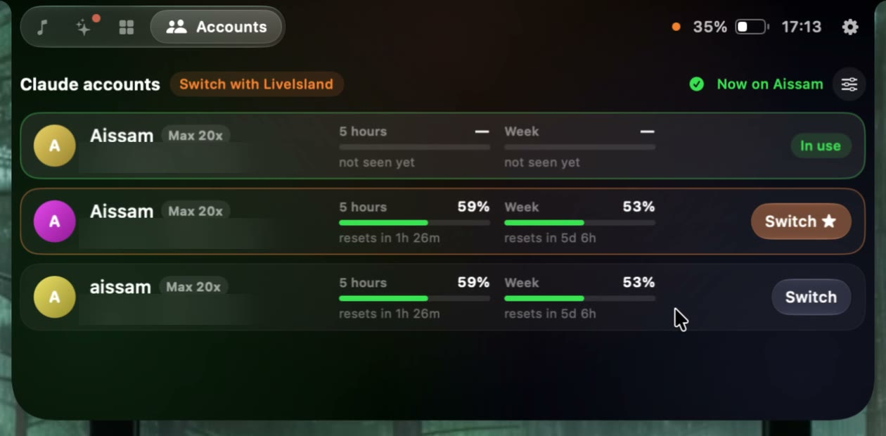
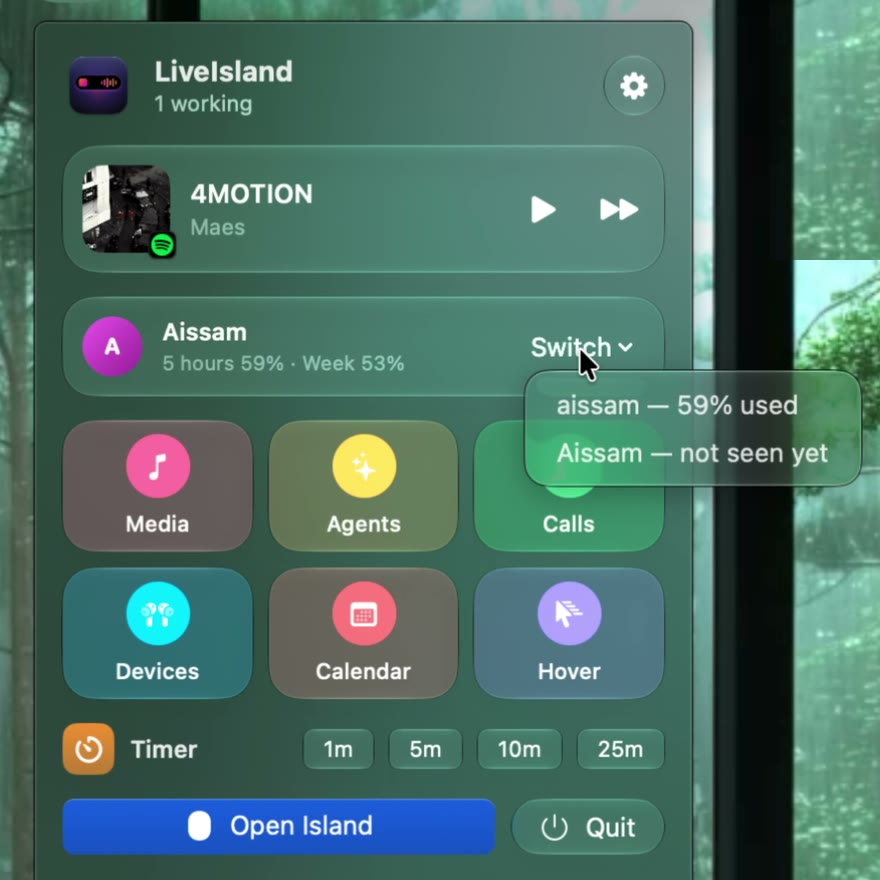

<div align="center">


# LiveIsland

**A Dynamic Island for the Mac's notch: what's playing, your AI agents and their limits, calls, AirPods, timers and your calendar.**


<br>

<a href="demo/demo.mp4"></a>

<sub>Media, AI agents, activity and Recently Played. <a href="demo/demo.mp4">Watch the full video</a>, with Settings and the menu bar panel.</sub>

</div>

---

## Screenshots

<table>
  <tr>
    <td align="center" width="33%">
      <br>
      <sub><b>Media</b><br>Any player, glow from the cover, Up Next</sub>
    </td>
    <td align="center" width="33%">
      <br>
      <sub><b>Agents</b><br>Sessions, states, real usage limits</sub>
    </td>
    <td align="center" width="33%">
      <br>
      <sub><b>Activity</b><br>Timer, calendar, battery, devices, privacy</sub>
    </td>
  </tr>
  <tr>
    <td align="center">
      <br>
      <sub><b>In the notch</b><br>Working, microphone in use, done</sub>
    </td>
    <td align="center">
      <br>
      <sub><b>Menu bar</b><br>Mini player and quick switches</sub>
    </td>
    <td align="center">
      <br>
      <sub><b>Settings</b><br>Everything, in one window</sub>
    </td>
  </tr>
</table>

## Features

**Now Playing**
- Works with any app that plays audio or video: Spotify, Music, browsers, podcasts…
- Reads **Spotify and Music directly** too, so a paused Spotify stays one tap away while a video plays in the browser. Switch players from the island
- Artwork with a **glow in the cover's colors**, live waveform, drag to scrub, ±15 s, previous / play / next
- **Up Next** from Music's playlist, and **Recently Played** for Spotify and Music: tap a track to play it again
- System volume and output device right under the player
- Music or Spotify not open? Their icons are there; tap to open and play

**AI agents**
- Every **Claude Code** and **Codex** session: working (with a timer), needs you, done, idle
- **Jump to the session** in the app it runs in: VS Code, Cursor, Antigravity or Windsurf (the right window), Terminal or iTerm2 (the exact tab)
- Copy the command that resumes a session
- **Usage limits as rings**: Claude Code's real 5-hour and weekly percentages (one click to set up, see below), Codex's 5-hour and weekly limits, tokens this window and today
- Optional sound when an agent finishes or stops to ask you something
- **Several Claude accounts**: each one's limits side by side, an alert in the notch when the account in use runs out, and one-tap switching (see below)

**Calls, devices and the rest**
- Call timer for FaceTime, Zoom, Teams, Discord, WhatsApp, Slack and more
- Which app is using the **microphone**, and whether the **camera** is on
- **AirPods** battery (left, right, case) when they connect; charging, and time left on battery
- Quick **timers**, your next **calendar** events, and a heads-up in the notch 10 minutes before
- The most important thing wins the notch: a call beats an agent that needs you, which beats music

**Everyday use**
- Opens on hover (or click), closes when you move away; clicks pass straight through everywhere else
- Settings window, menu bar panel, Open at Login, `liveisland://` links for Shortcuts
- Liquid Glass on macOS 26+, with a material fallback on earlier systems
- On Macs without a notch, the island sits at the top of the screen

## Claude Code limits

Claude Code shares its 5-hour and weekly percentages only with its status line. In **Settings › AI Agents**, click **Add to My Status Line**: LiveIsland adds three lines to your status line script, after it reads its input, and keeps a copy of the original next to it (`*.liveisland-backup`). The lines save the percentages to `~/.claude/liveisland-limits.json`, which the island reads.

Prefer to do it yourself? The lines are in [`scripts/claude-statusline-snippet.sh`](scripts/claude-statusline-snippet.sh). They go inside the status line script; typed into a terminal they do nothing. Without them, the island still shows Claude Code's tokens for the current 5-hour window and for today, counted from its transcripts.

## Claude accounts

<div align="center">
<a href="demo/accounts.mp4"></a>
</div>

<table>
  <tr>
    <td align="center" width="62%">
      <br>
      <sub><b>Accounts</b><br>Every account's limits; ★ marks the one with the most room</sub>
    </td>
    <td align="center" width="38%">
      <br>
      <sub><b>Menu bar</b><br>Switch without opening the island</sub>
    </td>
  </tr>
</table>

Use more than one Claude account? The **Accounts** tab lists every account Claude Code has used on this Mac, with its plan and its 5-hour and weekly limits. When the account in use runs out, the notch says so and points to the one with the most room. LiveIsland never switches on its own: you tap **Switch**.

Choose how switching works in **Settings › AI Agents**:

| | |
|---|---|
| **Off** (default) | Limits and alerts only. You switch with `/login` in Claude Code. |
| **LiveIsland** | LiveIsland keeps a copy of each account's login in your login Keychain and puts it in place when you tap Switch. Only the Claude login changes: your MCP server logins stay as they are. It holds Claude Code's own locks while it switches, so a login refresh can't collide with it, and running sessions move to the new account within about 30 seconds. |
| **claude-swap** | LiveIsland asks [claude-swap](https://github.com/realiti4/claude-swap) to switch and shows its live usage for every account. LiveIsland itself never touches a login. |

To add an account, run `/login` in Claude Code and sign in to it (a private browser window helps if you're signed in to claude.ai as someone else). Avoid `/logout`: it can cancel the saved login of the account you leave. Use one switcher at a time, since each keeps its own copy of every login.

LiveIsland learns an account's limits from the status line while you use it, and from the limit Claude reports when it refuses a request. An account you aren't using keeps its last numbers, and a window that has reset counts from zero.

## How it works

| What | Where it comes from |
|---|---|
| Now playing (any app) | MediaRemote, through the bundled [mediaremote-adapter](https://github.com/ungive/mediaremote-adapter): since macOS 15.4 only Apple-signed processes may read it, so the adapter runs inside `/usr/bin/perl` |
| Spotify and Music | Their own "track changed" notifications, and AppleScript for details and controls. LiveIsland never scripts an app that isn't running, since that would open it |
| Claude Code and Codex | Their session files (`~/.claude/projects`, `~/.codex/sessions`), watched with FSEvents. Transcripts can be gigabytes, so only new bytes are read |
| Where a session runs | The process table: each agent's folder and terminal, and the app above it |
| Claude accounts | Who's logged in from `~/.claude.json`; logins (only when you choose LiveIsland switching) through the system `security` tool, the way Claude Code itself stores them |
| Microphone, camera, calls | Core Audio's process list and CoreMediaIO. Only *whether* they're in use, never what they hear or see |
| Battery, AirPods | IOKit power notifications; IOBluetooth and `system_profiler` for AirPods levels |
| Calendar | EventKit, read only |

## Performance

Measured on an M4 Pro with Claude Code and Codex running and Spotify playing:

| | CPU |
|---|---|
| Island closed | under 1% of one core |
| Island open | about 9% while it's on screen (drawing) |
| First read of 460 Claude Code transcripts (2 GB) | about 3 s, once, in the background |
| Checking them again | 16 ms |

Nothing animates frame by frame unless you can see it: spinners and waveforms are drawn by Core Animation, clocks tick once a second, and mouse moves far from the notch are ignored.

## Install

```bash
git clone https://github.com/<your-username>/LiveIsland.git
cd LiveIsland
./scripts/install.sh   # builds, copies to ~/Applications and launches
```

You need the Xcode Command Line Tools and CMake (`brew install cmake`), which builds the media adapter. macOS will ask for:

- **Calendar**, for your next events
- **Bluetooth**, for AirPods battery
- **Automation** for Spotify and Music (now playing and controls), and for Terminal or iTerm2 the first time you jump to a session there
- Nothing for Claude accounts: switching is off until you turn it on, and the Keychain items it uses are written by the system `security` tool

Everything works without any of them; the matching feature just stays empty.

## Tests

```bash
./scripts/test.sh                                   # all tests
LIVEISLAND_REAL_DATA=1 ./scripts/test.sh -c release --filter RealData   # read your own transcripts, timed
```

The tests cover the transcript and rollout parsers, the incremental usage ledger (appends, truncation, replaced files, duplicate messages), 5-hour windows, limit notices that go stale, Claude Code's status line limits, now-playing stream updates, activity priorities, timers, session resume commands and editor window matching.

## Automation

| Link | Action |
|---|---|
| `liveisland://open` · `close` | Open or close the island |
| `liveisland://timer/5` | Start a 5-minute timer |
| `liveisland://settings` | Open Settings |

## Privacy

LiveIsland has no analytics and no accounts. Transcripts, calendar events and everything else stay on your Mac. Its only network request downloads Spotify's cover art, from the address Spotify itself gives.

## Credits

Now playing uses [mediaremote-adapter](https://github.com/ungive/mediaremote-adapter) by ungive (BSD-3-Clause), vendored in `ThirdParty/`. Claude Code, Codex, Spotify and the other apps named here belong to their owners; LiveIsland isn't affiliated with them.

## License

[MIT](LICENSE) © 2026 Aissam Irhir
